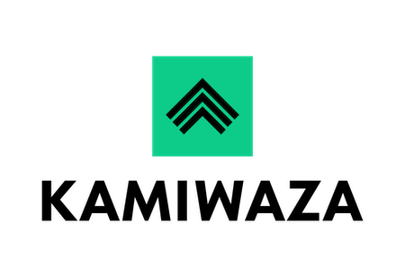

  

# Kamiwaza Community Edition

**Orchestrate Autonomous AI. Everywhere.**

Kamiwaza Community Edition is the enterprise-grade **AI orchestration platform** for developers. It provides the tools to manage the entire lifecycle of AI models, data, and applications — from data ingestion and vectorization to model serving and monitoring — on your local or remote machine.

## 🚀 Key Features

- **AI Orchestration**: Unified management for models, vector databases, and application deployment.
- **Universal Inference**: Run state-of-the-art AI models from Hugging Face on NVIDIA, AMD ROCm, Apple Silicon, Intel, and more.
- **Distributed Data Engine**: Built-in pipelines for unstructured data ingestion, processing, and vectorization.
- **App Garden**: Launch full-stack AI apps in seconds.
- **Enterprise-Grade Security**: OAuth/SAML authentication, role-based access control, and TLS encryption for single-node deployments.

## 📥 Get Started

Community Edition gives you the full GenAI stack for single-node use. For the latest installers (macOS, Windows MSI, Linux deb/rpm) and quickstart guides, visit our official documentation:

👉 **[docs.kamiwaza.ai](https://docs.kamiwaza.ai)**

## 💬 Support

- **Documentation**: [docs.kamiwaza.ai](https://docs.kamiwaza.ai)
- **Discord**: [Join the Community](https://discord.gg/cVGBS5rD2U)
- **Issues**: [GitHub Issues](https://github.com/kamiwaza-ai/kamiwaza-community-edition/issues)

## 📄 License

Copyright (c) 2023-2026 Kamiwaza Corp. All rights reserved.

Use of the Kamiwaza Community Edition is subject to the terms in the [LICENSE](LICENSE) file.
